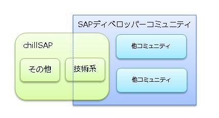

# コミュニティ名 chillSAP

読み方：ちる・えす・えー・ぴー

# どんなコミュニティ？  
[SAP](https://www.sap.com)関連情報をソーシャルメディア ([X](https://x.com/search?q=%23chillSAP&f=live), [Facebook](https://www.facebook.com/groups/chillSAP/)) やブログ等で発信しているメンバーが集まったコミュニティです。  
他のITコミュニティ同様に、オンライン⇔オフラインを大事にしていきたいと思っています。

[Code of Conducts](code_of_conducts.md)

# ハッシュタグ
#chillSAP

# 過去のイベント
[イベントまとめ](events.md)

# 今後の予定   
イベントの告知は X（[#chillSAP](https://x.com/search?q=%23chillSAP&f=live)）と [Facebook グループ](https://www.facebook.com/groups/chillSAP/)で行っています。  

# 連絡先
主催者の X アカウントまでお気軽にどうぞ。  
[@mahko2](https://x.com/mahko2) / [@minok104](https://x.com/minok104)

# よくある質問  

### chillSAPって何？  
chillSAP ⇒ SAPに関する人とゆるく繋がって、SAPに関することをゆるく話そうよ。

### TECH PLAYの「SAPディベロッパーコミュニティ」と何が違うの？  
SAPの方が作成したグループ「SAPディベロッパーコミュニティ」に所属していますが、chillSAP自体は技術以外の要素を含んだコミュニティです。  
chillSAPの技術系イベントの告知等はこちらで行わせていただきます。  
 
イメージとしてはこのような感じです。  

